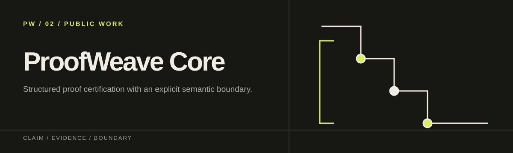

<p align="center">
  
</p>

# ProofWeave Core v2

[English](README.md) | [繁體中文](README.zh-TW.md) | [简体中文](README.zh-CN.md)

ProofWeave Core v2 は、AI が生成した数学の命題と証明を読み込み、簡潔な論文用の証明と proof spine／concept map を一度に出力します。対応できる場合は、Lean 証明書と正確な deductive coverage も出力します。

これはマルチエージェントの統治基盤ではありません。runtime には agents、workflows、providers、model router、budget manager、paper review、reviewer loop がなく、LLM も呼び出しません。

## クイックスタート

```powershell
py -3.14 -m pip install -e .
lake update mathlib
lake exe cache get
py -3.14 -m proofweave init
py -3.14 -m proofweave run examples/simple_ring/theorem.md --confirm-alignment
```

普段使うのは `py -3.14 -m proofweave run theorem.md` だけです。ほかのコマンドは `init`、`status [CLAIM_ID]`、読み取り専用の `check` です。

入力では、ID・仮定・量化・依存関係を TOML front matter に書き、本文を `## Statement` と `## Proof` に書きます。任意の `## Certificate` には、決まった形式で Lean の指定を置けます。長い証明では `### STEP_ID [semantic|bridge|computational|alias]` と `Depends:` を使います。

`CERTIFIED` になるのは、deterministic Lean result が 100% coverage に達した場合だけです。alignment は独立した状態です。`CERTIFIED + UNCONFIRMED` は Lean が formal target を証明したことだけを表し、自然言語の命題と同値であることは意味しません。`run --confirm-alignment` は hash で結び付けた人間の確認を記録し、内容が変わるとその確認は `STALE` になります。

Lean で使える手法は `ring`、`ring_nf`、`norm_num`、`linarith`、`nlinarith`、`positivity` と制限付きの `exact` だけです。任意の command/import、`sorry`、`admit`、独自の axiom、unsafe meta、`run_tac`、`native_decide` は拒否します。Lean/Mathlib がない環境では、結果は `PARTIAL/HOST_LIMITED` になります。

このシステムは、全体で最も簡潔な証明を見つけたとは主張しません。自然言語と Lean target の意味が一致することも、自動では証明しません。v1 のデータは `py -3.14 -m tools.migrate_v1 OLD_FACT_GRAPH --root .` で一度だけ移行でき、人手による `VERIFIED` は `UNVERIFIED` になります。

## テストと論文用エビデンス

開発用のテストは固定した test-only dependencies を使うため、runtime dependency は増えません。

```powershell
py -3.14 -m pip install -e . -r requirements-test.txt
py -3.14 -m coverage run -m unittest discover -s tests -v
py -3.14 -m coverage report --fail-under=90 --show-missing
py -3.14 -m proofweave check
py -3.14 -m tools.evaluate core --output artifacts/evaluation
py -3.14 -m tools.evaluate pack PACK.toml --output artifacts/evaluation
```

CI は Ubuntu と Windows の Python 3.11/3.14 で高速テストを実行し、両方のプラットフォームで固定版の Lean/Mathlib による実際の認証を行います。手動の workflow は候補エビデンスを生成します。`v*.*.*` tag は draft release を作るだけで、自動では公開しません。

有限 corpus での結果は `COMPUTATIONAL` にすぎず、coverage も soundness の証明ではありません。Lean certificate が証明するのは、その formal target だけです。自然言語との alignment には、hash で結び付けた人手の attestation が必要です。公開済みの解決策が見つからないことは、問題が未解決であることや新規性の証明にはなりません。冷間再生、新規性の再確認、独立レビューを結び付けられる将来の schema ができるまで、Evidence-pack schema v1 は `VERIFIED` を fail closed にします。詳しくは [評価プロトコル](docs/evaluation_protocol.md) と [claim–evidence matrix](docs/claim_evidence_matrix.md) を参照してください。
