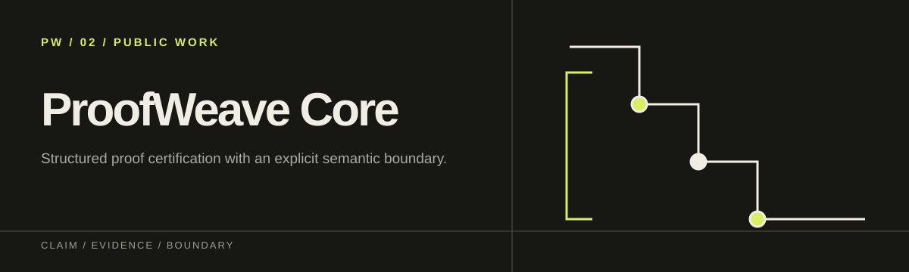

<p align="center">
  
</p>

# ProofWeave Core v2

[繁體中文](README.zh-TW.md) · [简体中文](README.zh-CN.md) · [日本語](README.ja.md)

[](https://github.com/f0909172434/proofweave-math-lab/actions/workflows/ci.yml)
[](https://github.com/f0909172434/proofweave-math-lab/actions/workflows/codeql.yml)
[](pyproject.toml)
[](lean-toolchain)
[](LICENSE)

**ProofWeave Core checks a structured mathematical proof against Lean and records which steps were certified and which were not.**

ProofWeave Core v2 reads one mathematical claim written in UTF-8 Markdown and writes:

- a normalized UTF-8 copy of the parsed input, while `source_hash` still binds the raw input bytes;
- a short paper-proof view and a Mermaid proof-spine and concept map;
- deductive coverage for each obligation;
- a generated Lean source file and a deterministic certificate result, when the claim falls inside
  the deliberately small certificate language; and
- content-addressed run metadata, hashes and an explicit claim-revision state.

Core does not discover proofs, translate arbitrary natural language into Lean, or call an LLM.
It has no agents, providers, prompts, model router, reviewer loop, hosted service or telemetry.
It certifies formal targets that the author supplies, and it marks every obligation it cannot
certify as `PARTIAL` in the output.

> **Project status.** ProofWeave is experimental research infrastructure. The published
> repository and evidence release is `v0.1.0`, while the Core runtime, package and protocol are
> version `2.0.0`. The two version numbers track different things.

The [published release](https://github.com/f0909172434/proofweave-math-lab/releases/tag/v0.1.0)
for `v0.1.0` records 42/42 fixed-corpus cases passing. That includes 14/14 positive cases, zero
false certifications across 14 paired negative cases, and 0/8 accepted escape attacks. The
[tagged CI run](https://github.com/f0909172434/proofweave-math-lab/actions/runs/31348288988)
ran 79 fast tests at 96% branch-aware coverage with two Lean-dependent skips. Its real-Lean jobs
ran all 79 tests at 97% coverage with zero permitted skips on both Ubuntu and Windows, using pinned
Lean/Mathlib 4.32.2.

These are `COMPUTATIONAL` results on a finite corpus. They do not establish global soundness,
completeness, absence of defects, semantic equivalence between prose and a formal target, or the
truth of any theorem beyond the exact certified target.

## See the result first

Running the bundled ring identity with the pinned toolchain gives a result of the following shape.
It is abridged, and paths and hashes are shortened:

```json
{
  "claim_id": "square-successor",
  "proof_status": "CERTIFIED",
  "alignment": "UNCONFIRMED",
  "fast_path": true,
  "cache_hit": false,
  "coverage": {
    "deductive_total": 1,
    "certified": 1,
    "failed": 0,
    "unsupported": 0,
    "host_limited": 0,
    "percentage": 100.0,
    "dependencies_ready": true
  },
  "invocations": {
    "model": 0,
    "semantic_extraction": 0,
    "certifier": 1
  },
  "artifact_directory": ".../artifacts/square-successor/<run-id>"
}
```

The result is `CERTIFIED + UNCONFIRMED` on purpose. Lean proved the exact formal target, but
ProofWeave did not conclude that the target means the same thing as the human statement. If you
run the unchanged input again, Core reuses the verified artifact only after checking its hashes.
That second run returns `cache_hit: true` with zero model, semantic-extraction and certifier
invocations.

The [recorded simple-ring walkthrough](docs/walkthroughs/simple-ring/README.md) shows a real run with the exact input, the generated Lean, the certificate hashes and a cache-hit readback.

## When ProofWeave fits

Use Core when you need to:

- put an algebraic or arithmetic claim behind a pinned Lean check;
- show which steps of a longer proof have certificates and which remain unsupported;
- keep assumptions, quantifiers, claim dependencies, revisions and lifecycle visible, instead of
  collapsing them into one “verified” label;
- detect dependency cycles, missing active dependencies, stale alignment and tampered cached
  artifacts deterministically;
- produce a conservative paper view and proof map without changing the certificate obligations; or
- build a reproducible evaluation bundle with checksums for a fixed corpus or a theorem pack.

Core is not a good fit when you need:

- automated proof search, natural-language formalization, arbitrary Lean tactics or imports, or an
  interactive proof-assistant UI;
- mathematical discovery, literature search, novelty determination, peer review, or proof of a
  theorem's real-world interpretation;
- multi-agent orchestration, model routing, research project management, or a hosted
  collaboration database; or
- a guarantee of global soundness, completeness or the “simplest proof”.

## Quick start from source

### 1. Prerequisites

You need:

- Python 3.11 or newer;
- Git; and
- [Elan](https://github.com/leanprover/elan), the Lean toolchain manager.

The repository pins Lean in [`lean-toolchain`](lean-toolchain), Mathlib in
[`lakefile.toml`](lakefile.toml), and every dependency revision in
[`lake-manifest.json`](lake-manifest.json). The bootstrap commands call `lake` from the shell, but
certification takes `lean` and `lake` from the Elan-managed directory that the project pin selects,
or from `ELAN_HOME`. A shim that exists only on `PATH` does not count as a pinned certifier.

### 2. Install and freeze the formal environment

```console
git clone https://github.com/f0909172434/proofweave-math-lab.git
cd proofweave-math-lab
python -m pip install --no-deps --editable .
lake update mathlib
lake exe cache get
```

On Windows, `py -3.14` can replace `python` in every command. The first Mathlib checkout and cache
download can take several minutes. Core itself has no Python runtime dependency, and Lean/Mathlib
is needed only for real certification. Without the complete pinned environment, Core fails closed
with `PARTIAL/HOST_LIMITED` and does not produce a certificate.

### 3. Initialize and certify the example

```console
python -m proofweave init
python -m proofweave run examples/simple_ring/theorem.md
python -m proofweave status square-successor
```

`init` creates `workspace/claims/` and `artifacts/` without overwriting existing files. `run`
prints JSON and writes the complete run. `status` reads the claim revision state and returns counts
for each of the three independent status axes.

Do not add `--confirm-alignment` out of habit. Use it only after a person has compared the exact
`## Statement` and its quantifiers with the Lean `target`, and has separately checked that the
assumptions and dependencies match the intended theorem. The command then records a local
alignment attestation:

```console
python -m proofweave run examples/simple_ring/theorem.md --confirm-alignment
```

The alignment hash binds `statement_hash`, which covers the statement and its quantifiers, to the
hash of the formal target. The stored source hash detects any other edit to the source. The flag
does not authenticate the reviewer, and it does not establish novelty, peer review or truth beyond
the encoded formal target. After a later source change, the stored alignment shows as `STALE` until
someone inspects and runs the new revision.

## Input contract

A claim starts with TOML front matter, followed by `## Statement` and `## Proof`. A certificate
for the whole claim goes in an optional `## Certificate` section:

````markdown
+++
claim_id = "square-successor"
title = "Square of a successor"
assumptions = ["x is an integer"]
quantifiers = ["for every integer x"]
dependencies = []
+++

## Statement

For every integer x, (x + 1)^2 = x^2 + 2x + 1.

## Proof

Expand the square and collect like terms.

## Certificate

```proofweave-lean
target = "forall x : Int, (x + 1)^2 = x^2 + 2*x + 1"
tactic = "ring"
```
````

The parser enforces these rules:

- `claim_id` must match `[A-Za-z0-9][A-Za-z0-9._-]{0,63}`.
- `assumptions` must be explicit. Use `["none"]` when there are none.
- `quantifiers` and `dependencies` are arrays. Every dependency must already
  have exactly one `ACTIVE` claim revision in the same project.
- Claim dependencies and proof-node dependencies must be acyclic.
- Unknown front-matter and certificate fields fail closed.
- Input bytes must be UTF-8.

### Longer, partially formalized proofs

When there is no whole-claim `## Certificate`, Core builds one deterministic proof IR. Write the
proof with headings of the following form:

````markdown
### normalize [computational]

Normalize the polynomial endpoint.

```proofweave-lean
target = "(20 + 22 : Int) = 42"
tactic = "norm_num"
```

### interpret [semantic]
Depends: normalize

Explain why the certified endpoint establishes the intended mathematical step.
````

The roles are `semantic`, `bridge`, `computational`, and `alias`. Every node other than an `alias`
is a deductive obligation. A node without a supported certificate stays in the output as
unsupported, which makes the whole run `PARTIAL`. Core never starts a reviewer loop to hide the
gap. The bundled [`partial_proof`](examples/partial_proof/theorem.md) example shows this case.

## Commands and exit status

Core deliberately exposes exactly four top-level commands:

| Command | What it does | Writes project state? |
| --- | --- | --- |
| `proofweave init [--root DIR]` | Create `workspace/claims/` and `artifacts/` | Only missing directories |
| `proofweave run INPUT [--root DIR] [--confirm-alignment]` | Parse, certify, render, hash, and record one claim revision | Yes |
| `proofweave status [CLAIM_ID] [--root DIR]` | Show stored revisions and counts by status axis | No |
| `proofweave check [--root DIR]` | Verify schemas, hashes, DAGs, artifact integrity, and Core budgets | No |
You can use either the installed `proofweave` entry point or `python -m proofweave`. The exit
codes are designed to be safe for automation:

| Invocation | Exit `0` | Exit `1` | Exit `2` |
| --- | --- | --- | --- |
| `run` | `CERTIFIED` | `FAILED` or invalid input/runtime error | `PARTIAL`, including `HOST_LIMITED` |
| `check` | `PASS` | `FAIL` or error | — |
| `init`, `status` | Success | Error | — |
Treat exit `2` as an incomplete proof, not as a successful run with a warning.

## Reading the three status axes

The three axes are independent, so never infer one from another.

| Axis | Values | Meaning |
| --- | --- | --- |
| `proof_status` | `UNVERIFIED`, `PARTIAL`, `CERTIFIED`, `FAILED` | Machine-certificate result for this revision. `UNVERIFIED` is retained for records such as conservative v1 migrations. |
| `alignment` | `UNCONFIRMED`, `CONFIRMED`, `STALE` | Whether a human hash-bound statement/formal-target comparison is current. |
| `lifecycle` | `ACTIVE`, `SUPERSEDED`, `REVOKED` | Revision governance; it does not change certificate truth. |
Common combinations:

- `CERTIFIED + UNCONFIRMED + ACTIVE` means Lean proved the formal target, and nobody has yet
  attested that the prose is equivalent.
- `CERTIFIED + CONFIRMED + ACTIVE` means the formal target passed and a human attested the bound
  pair. This still says nothing about novelty or peer review.
- `CERTIFIED + STALE` means the earlier certificate record still exists, but the source bytes
  changed after alignment. Inspect the claim again and re-run it.
- `PARTIAL + UNCONFIRMED` means at least one obligation is unsupported, or the host lacks the
  pinned Lean environment.
- `FAILED` means Lean rejected at least one submitted formal obligation.

The research-pack statuses `OPEN`, `PROPOSED`, `COMPUTATIONAL` and `VERIFIED` belong to a
separate evidence layer and are not a fourth Core claim axis. The current theorem-pack schema
rejects every `VERIFIED` pack on purpose, because it cannot yet bind all the required evidence of
independent review and novelty.

## Pipeline and artifact layout

```text
UTF-8 TOML + Markdown
        │
        ▼
preserving parser ──► revision/hash identity ──► claim + proof DAG checks
        │
        ▼
pinned-environment fingerprint ──► cache validation ──► allowlisted Lean batch
        │
        ▼
exact coverage/status ──► conservative rendering ──► hashed run + claim state
```

A fast-path run writes:

```text
workspace/claims/
└── square-successor--<revision-prefix>.json

artifacts/square-successor/<run-id>/
├── input.md
├── paper_proof.md
├── concept_map.md
├── coverage.json
├── certificate.json
├── certificate.lean
├── run.json
└── run.sha256
```

Structured long proofs also write `proof_ir.json`. `paper_proof.md` and `concept_map.md` are
presentation views and never add proof authority. `run.json` records the hash of every payload
artifact, and `run.sha256` separately protects that run record. A cache key binds the material
claim, certificate, dependency, certifier and toolchain inputs. Core never silently reuses an
artifact that is missing, moved, inconsistent or modified.

## Certificate language and trust boundary

The generated Lean file always starts with a fixed `import Mathlib` and disables automatic
implicit parameters. The certificate block accepts only:

- `ring`, `ring_nf`, `norm_num`, `linarith`, `nlinarith`, and `positivity`; or
- a restricted `exact` that refers to an earlier certified node in the same generated batch.

Core rejects arbitrary commands and imports, tactics outside the allowlist, `sorry`, `admit`,
custom axioms, unsafe or meta execution, `run_tac`, `native_decide`, and any certificate syntax
that tries to define its own theorem or declaration.

Certification and cache reuse are bound to:

- the statement, assumptions, quantifiers, and dependency certificate digests;
- the complete certificate view and certifier version;
- `lean-toolchain`, `lakefile.toml`, `lake-manifest.json`;
- Elan-managed Lean/Lake executables and Lean library artifacts; and
- exact, clean dependency Git revisions plus the observed Lean-artifact
  digests.

The trusted computing base still includes the Python implementation, the operating system, the
Git executable, the Elan-managed Lean toolchain, the Lean kernel and compiler, and the pinned
Mathlib dependency closure. Hashes detect changed bytes, but they do not prove that the host was
uncompromised. A passing Lean result proves only the generated formal target in that environment.
It does not establish:

- equivalence to the natural-language statement without human alignment;
- truth of informal assumptions or the intended domain interpretation;
- novelty, openness, publication priority, peer review, or expert consensus;
- completeness of the tactic allowlist or absence of every implementation bug;
  or
- global Lean/Mathlib/host soundness.

The [threat model](docs/design/threat_model.md) and the
[Core v2 architecture record](docs/v2_refactor.md), which documents the destructive v2 refactor,
describe the full boundary.

## Evaluation and theorem packs

Install the pinned test-only dependencies, then run the local gate:

```console
python -m pip install -r requirements-test.txt
python -m coverage run -m unittest discover -s tests -v
python -m coverage report --fail-under=90 --show-missing
python -m proofweave check
python -m tools.check_workflow_security
```

To produce a real fixed-corpus evidence bundle, first set up the pinned Lean environment as in the
quick start, then require it explicitly:

```powershell
$env:PROOFWEAVE_REQUIRE_LEAN = "1"
python -m tools.evaluate core --output artifacts/evaluation
```

On POSIX shells, use
`PROOFWEAVE_REQUIRE_LEAN=1 python -m tools.evaluate core --output artifacts/evaluation`.
The bundle contains `evaluation.json`, `summary.md`, `environment.txt`, the retained Lean sources
and `SHA256SUMS`.

The fixed corpus has 42 stable cases: 14 positive, 14 paired negative, 8 escape attempts and 6
fail-closed state and integrity cases, plus a cold and a warm replay. A passing result is
`COMPUTATIONAL` evidence on a finite corpus, not a proof of global soundness. The
[evaluation protocol](docs/evaluation_protocol.md) and the
[claim–evidence matrix](docs/claim_evidence_matrix.md) cover research packs, the attestation
format, release evidence and the exact limits on promotion.

CI runs Python 3.11 and 3.14 on Ubuntu and Windows, with real pinned Lean certification on both
platforms. Tag workflows build and attest candidate evidence and create only a **draft** release.
Publishing that release remains a separate human action.

## Relationship to the other projects

These repositories complement each other, but none depends on another at runtime, and they do not
exchange data automatically:

| Project | Narrow responsibility |
| --- | --- |
| **ProofWeave Core** | Certify exact formal targets, expose partial obligations, and retain content-addressed proof runs. |
| [RigorGraph](https://github.com/f0909172434/rigorgraph) | Audit broader claim–evidence traceability and human workflow records; it is not a theorem prover. |
| [HonestCI](https://github.com/f0909172434/honest-ci) | Check whether expected test evidence actually ran; it makes no mathematical truth claim. |
## Development and migration

Read [CONTRIBUTING.md](CONTRIBUTING.md) before changing Core. The enforced design budget is ten
production modules, three schemas, four commands, no Python runtime dependencies, and no model
calls or reviewer loops. A supported cold run may use at most one Lean batch, and an unchanged warm
run must do zero extra work.

Core v1 can still be recovered from Git history. v2 does not ship a compatibility runtime. A
one-time migration of formal records is available as an explicit tool:

```console
python -m tools.migrate_v1 OLD_FACT_GRAPH --root .
```

Migration keeps the formal statement fields and dependencies after validating them. Non-formal
evidence is reported and skipped. Every human `VERIFIED` record from v1 maps conservatively to
`UNVERIFIED + UNCONFIRMED`, never to `CERTIFIED`.

## License and security

ProofWeave Core is available under the [MIT License](LICENSE). Please report suspected
vulnerabilities as described in [SECURITY.md](SECURITY.md), not in a public issue.
