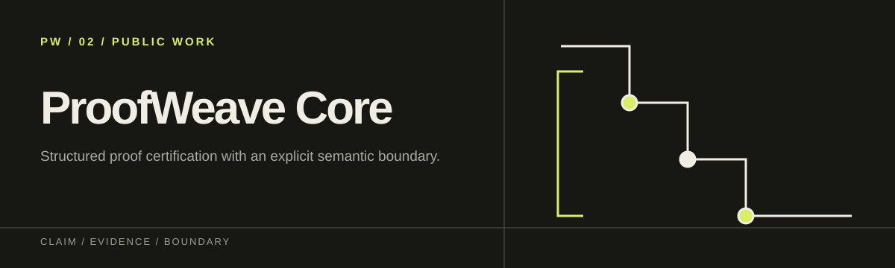

<p align="center">
  
</p>

# ProofWeave Core v2

[English](README.md) | [繁體中文](README.zh-TW.md) | [日本語](README.ja.md)

ProofWeave Core v2 读取 AI 生成的数学命题与证明，一次输出精简的论文式证明与 proof spine／concept map。能够认证时，它还会输出 Lean 证书与精确的 deductive coverage。

它不是多代理治理平台。runtime 中没有 agents、workflows、providers、model router、budget manager、paper review 或 reviewer loop，也不调用 LLM。

## 快速开始

```powershell
py -3.14 -m pip install -e .
lake update mathlib
lake exe cache get
py -3.14 -m proofweave init
py -3.14 -m proofweave run examples/simple_ring/theorem.md --confirm-alignment
```

日常使用只需要 `py -3.14 -m proofweave run theorem.md`。另外三个命令是 `init`、`status [CLAIM_ID]` 和只读的 `check`。

输入用 TOML front matter 记录 ID、假设、量词与依赖，正文使用 `## Statement` 与 `## Proof`，`## Certificate` 可以省略。长证明可以使用 `### STEP_ID [semantic|bridge|computational|alias]` 标题与 `Depends:`。

只有 deterministic Lean result 达到 100% coverage 时，才会得到 `CERTIFIED`。`alignment` 是独立的状态，`CERTIFIED + UNCONFIRMED` 只表示 Lean 证明了 formal target。`run --confirm-alignment` 会记录一份绑定 hash 的人工确认。内容改变后，这份确认会变成 `STALE`。

Lean 只允许 `ring`、`ring_nf`、`norm_num`、`linarith`、`nlinarith`、`positivity` 和受限的 `exact`，并拒绝任意 command 或 import、`sorry`、`admit`、自定义 axiom、unsafe meta、`run_tac` 与 `native_decide`。缺少 Lean/Mathlib 时，结果只能是 `PARTIAL/HOST_LIMITED`。

系统不宣称找到了全局最简的证明，也不会自动证明自然语言与 Lean target 语义等价。v1 数据可以用 `py -3.14 -m tools.migrate_v1 OLD_FACT_GRAPH --root .` 一次性迁移，人工标记的 `VERIFIED` 会映射为 `UNVERIFIED`。

## 测试与论文证据

开发测试使用锁定版本的 test-only dependencies，不会增加 runtime dependency：

```powershell
py -3.14 -m pip install -e . -r requirements-test.txt
py -3.14 -m coverage run -m unittest discover -s tests -v
py -3.14 -m coverage report --fail-under=90 --show-missing
py -3.14 -m proofweave check
py -3.14 -m tools.evaluate core --output artifacts/evaluation
py -3.14 -m tools.evaluate pack PACK.toml --output artifacts/evaluation
```

CI 在 Ubuntu 与 Windows 上以 Python 3.11 和 3.14 运行快速测试，并在两个平台上使用锁定版本的 Lean/Mathlib 做真实认证。手动触发的 workflow 会产生候选证据。`v*.*.*` tag 只会创建 draft release，不会自动发布。

有限 corpus 上的结果只是 `COMPUTATIONAL`，coverage 也不是 soundness 的证明。单一 Lean certificate 只证明它自己的 formal target，自然语言的 alignment 需要绑定 hash 的人工确认。文献搜索“未找到解答”，不等于证明问题仍未解决或具有新颖性。在未来的 schema 能够绑定冷启动重放、新颖性复查与独立审查证据之前，Evidence-pack schema v1 对 `VERIFIED` 一律 fail closed。详见 [评估协议](docs/evaluation_protocol.md) 与 [claim–evidence matrix](docs/claim_evidence_matrix.md)。
