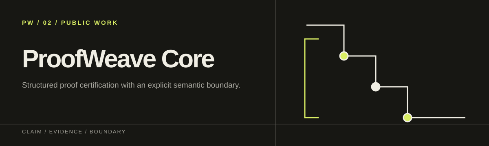

<p align="center">
  
</p>

# ProofWeave Core v2

[English](README.md) · [简体中文](README.zh-CN.md) · [日本語](README.ja.md)

[](https://github.com/f0909172434/proofweave-math-lab/actions/workflows/ci.yml)
[](https://github.com/f0909172434/proofweave-math-lab/actions/workflows/codeql.yml)
[](pyproject.toml)
[](lean-toolchain)
[](LICENSE)

**ProofWeave Core 用 Lean 檢查結構化數學證明所附的 formal target，並記錄哪些步驟通過認證、哪些沒有。**

ProofWeave Core v2 讀取一份以 UTF-8 Markdown 寫成的數學命題，並輸出以下內容：

- 解析後正規化的 UTF-8 輸入副本，原始輸入的 bytes 另由 `source_hash` 綁定；
- 精簡的論文式證明，以及 Mermaid 格式的 proof spine 與 concept map；
- 每一項 deductive obligation 的涵蓋情形；
- 命題落在刻意縮小的 certificate 語言範圍內時，產生的 Lean 原始碼與 deterministic certificate 結果；
- 以內容定址的 run metadata、雜湊值，以及明確的 claim revision 狀態。

Core 不會自己找證明，不會把任意自然語言翻成 Lean，也不會呼叫 LLM。
它沒有 agents、providers、prompts、model router、reviewer loop、託管服務或 telemetry。
它只認證作者明確提供的 formal target。無法認證的 obligation 會在輸出中標為 `PARTIAL`，不會被包裝成成功。

> **專案狀態：**這是實驗性的研究基礎設施。已發布的 repository 與 evidence release
> 是 `v0.1.0`，Core 的 runtime、package 與 protocol 則是 `2.0.0`。這兩個版本號各自追蹤不同的東西。

[公開 release](https://github.com/f0909172434/proofweave-math-lab/releases/tag/v0.1.0)
記錄了 `v0.1.0` 在固定語料上 42/42 通過。其中 positive cases 為 14/14，14 個成對 negative
cases 被錯誤認證的數量為 0，8 個 escape attacks 的接受數為 0。
[該 tag 的 CI](https://github.com/f0909172434/proofweave-math-lab/actions/runs/31348288988)
執行了 79 個 fast tests，branch-aware coverage 為 96%，其中有 2 個測試因需要 Lean
而略過。真實 Lean 的 jobs 在 Ubuntu 與 Windows 上都跑完全部 79 個測試，coverage
為 97%，允許略過的測試數為 0，使用的是固定版本的 Lean/Mathlib 4.32.2。

這些是在有限語料上得到的 `COMPUTATIONAL` 結果。它們不能證明全域 soundness 或
completeness，不能證明沒有缺陷，不能證明自然語言與 formal target 語意等價，也不能證明受認證
target 以外的任何定理為真。

## 先看結果

用固定的工具鏈執行內建的環恆等式範例，會得到以下形式的結果。內容已經刪節，路徑與雜湊也縮短了：

```json
{
  "claim_id": "square-successor",
  "proof_status": "CERTIFIED",
  "alignment": "UNCONFIRMED",
  "fast_path": true,
  "cache_hit": false,
  "coverage": {
    "deductive_total": 1,
    "certified": 1,
    "failed": 0,
    "unsupported": 0,
    "host_limited": 0,
    "percentage": 100.0,
    "dependencies_ready": true
  },
  "invocations": {
    "model": 0,
    "semantic_extraction": 0,
    "certifier": 1
  },
  "artifact_directory": ".../artifacts/square-successor/<run-id>"
}
```

結果是 `CERTIFIED + UNCONFIRMED`，這是刻意的設計。Lean 證明了精確的 formal target，
但 ProofWeave 不會自行推論這個 target 與人寫的命題意思相同。輸入沒有改變而再跑一次時，Core 會先核對
artifact 的雜湊值，才重用已驗證的結果。第二次執行會回傳 `cache_hit: true`，model、semantic
extraction 與 certifier 的呼叫次數都是 0。

## 適合與不適合的情境

適合用在以下情境：

- 用固定版本的 Lean 工具鏈檢查代數或算術命題；
- 清楚顯示長證明中哪些步驟有 certificate、哪些仍然 unsupported；
- 把 assumptions、quantifiers、claim dependencies、revision 與 lifecycle 分開管理；
- 以 deterministic 的方式拒絕依賴循環、缺少 active dependency、過期的 alignment，以及遭竄改
  的 cache artifact；
- 在不改變 certificate obligations 的前提下，輸出保守的 paper view 與 proof map；
- 為固定 corpus 或 theorem pack 產生可重現、附 checksum 的 evaluation bundle。

不適合用在以下情境：

- 自動 proof search、自然語言 formalization、任意 Lean tactic 或 import、互動式證明介面；
- 數學發現、文獻搜尋、新穎性判定、peer review，或保證定理在現實世界中的意義；
- multi-agent orchestration、model routing、研究專案管理或託管的協作資料庫；
- 保證 global soundness、completeness 或「最簡證明」。

## 從原始碼快速開始

### 1. 前置需求

- Python 3.11 以上；
- Git；
- [Elan](https://github.com/leanprover/elan)，也就是 Lean 的 toolchain manager。

Repository 用 [`lean-toolchain`](lean-toolchain) 固定 Lean 版本，用
[`lakefile.toml`](lakefile.toml) 固定 Mathlib 版本，並在
[`lake-manifest.json`](lake-manifest.json) 固定所有 dependency 的 revision。
初始化指令雖然從 shell 呼叫 `lake`，但實際認證時，Core 會依專案的 pin 從 Elan 管理的目錄
（或 `ELAN_HOME`）找 `lean` 與 `lake`。只存在於 PATH 上的 shim 不算固定版本的 certifier。

### 2. 安裝並固定 formal environment

```console
git clone https://github.com/f0909172434/proofweave-math-lab.git
cd proofweave-math-lab
python -m pip install --no-deps --editable .
lake update mathlib
lake exe cache get
```

在 Windows 上，可以把每個 `python` 換成 `py -3.14`。第一次下載 Mathlib checkout 與 cache
可能需要幾分鐘。Core 本身沒有 Python runtime dependency，只有真正認證時才需要完整的
Lean/Mathlib。環境不完整時，Core 會 fail closed，回傳 `PARTIAL/HOST_LIMITED`，
不會捏造 certificate。

### 3. 初始化並認證範例

```console
python -m proofweave init
python -m proofweave run examples/simple_ring/theorem.md
python -m proofweave status square-successor
```

`init` 只建立缺少的 `workspace/claims/` 與 `artifacts/`。`run` 會在終端輸出
JSON，並寫入完整的 run。`status` 讀取 claim revision，並依三個獨立的狀態軸分別統計。

不要習慣性地加上 `--confirm-alignment`。必須先由人比對精確的 `## Statement`、它的
quantifiers 與 Lean 的 `target`，並另外確認 assumptions 與 dependencies 符合想證明的定理，
再用以下命令建立本地的 alignment attestation：

```console
python -m proofweave run examples/simple_ring/theorem.md --confirm-alignment
```

Alignment hash 把 `statement_hash`（statement 加上 quantifiers）與 formal target 的雜湊綁在一起。
儲存的 source hash 則會偵測 source 的其他修改。這個 flag 不會驗證 reviewer 的身分，
也不代表新穎性、peer review，或 formal target 以外的真實性。Source 變動之後，
儲存的 alignment 會顯示為 `STALE`，直到有人檢查並執行新的 revision。

## 輸入契約

Claim 以 TOML front matter 開頭，接著是 `## Statement` 與 `## Proof`。整份 claim 的
certificate 放在可選的 `## Certificate` 段落：

````markdown
+++
claim_id = "square-successor"
title = "Square of a successor"
assumptions = ["x is an integer"]
quantifiers = ["for every integer x"]
dependencies = []
+++

## Statement

For every integer x, (x + 1)^2 = x^2 + 2x + 1.

## Proof

Expand the square and collect like terms.

## Certificate

```proofweave-lean
target = "forall x : Int, (x + 1)^2 = x^2 + 2*x + 1"
tactic = "ring"
```
````

解析時有以下規則：

- `claim_id` 必須符合 `[A-Za-z0-9][A-Za-z0-9._-]{0,63}`。
- `assumptions` 必須明確列出，沒有假設時寫 `["none"]`。
- `quantifiers` 與 `dependencies` 是陣列。每個 dependency 在同一專案中都必須已經有
  唯一一個 `ACTIVE` claim revision。
- Claim dependencies 與 proof-node dependencies 都必須是無環的 DAG。
- 不明的 front-matter 或 certificate 欄位會 fail closed。
- 輸入的 bytes 必須是 UTF-8。

### 較長、只有部分 formalization 的證明

沒有整份 claim 的 `## Certificate` 時，Core 會建立一份 deterministic 的 proof IR：

````markdown
### normalize [computational]

Normalize the polynomial endpoint.

```proofweave-lean
target = "(20 + 22 : Int) = 42"
tactic = "norm_num"
```

### interpret [semantic]
Depends: normalize

Explain why the certified endpoint establishes the intended mathematical step.
````

節點的角色有 `semantic`、`bridge`、`computational`、`alias` 四種。除了 `alias` 以外，
每個 node 都是 deductive obligation。沒有受支援 certificate 的 node 會原樣保留為
unsupported，整個 run 因此是 `PARTIAL`。Core 不會啟動 reviewer loop 來掩蓋這個缺口。
內建的 [`partial_proof`](examples/partial_proof/theorem.md) 範例示範了這種情況。

## 四個命令與退出碼

| 命令 | 功能 | 是否寫入專案狀態 |
| --- | --- | --- |
| `proofweave init [--root DIR]` | 建立 `workspace/claims/` 與 `artifacts/` | 只建立缺少目錄 |
| `proofweave run INPUT [--root DIR] [--confirm-alignment]` | 解析、認證、render、hash 並記錄一個 claim revision | 是 |
| `proofweave status [CLAIM_ID] [--root DIR]` | 顯示 revisions 與各狀態軸統計 | 否 |
| `proofweave check [--root DIR]` | 核對 schemas、hashes、DAG、artifact integrity 與 Core budgets | 否 |
可以使用安裝後的 `proofweave`，也可以用 `python -m proofweave`。退出碼的設計適合自動化流程：

| 呼叫 | Exit `0` | Exit `1` | Exit `2` |
| --- | --- | --- | --- |
| `run` | `CERTIFIED` | `FAILED` 或 input/runtime error | `PARTIAL`，包括 `HOST_LIMITED` |
| `check` | `PASS` | `FAIL` 或 error | — |
| `init`、`status` | 成功 | Error | — |
Exit `2` 代表證明尚未完成，不是可以忽略的警告。

## 判讀三個正交狀態軸

三個狀態軸互相獨立，不能從其中一個推論另一個：

| 狀態軸 | 值 | 含義 |
| --- | --- | --- |
| `proof_status` | `UNVERIFIED`, `PARTIAL`, `CERTIFIED`, `FAILED` | 本 revision 的 machine-certificate 結果；`UNVERIFIED` 也保留給 v1 保守遷移等紀錄。 |
| `alignment` | `UNCONFIRMED`, `CONFIRMED`, `STALE` | 人類對 statement/formal-target 的 hash-bound 比對是否仍有效。 |
| `lifecycle` | `ACTIVE`, `SUPERSEDED`, `REVOKED` | Revision 治理，不會改寫 certificate truth。 |
常見的組合：

- `CERTIFIED + UNCONFIRMED + ACTIVE`：Lean 證明了 formal target，但還沒有人確認它與
  文字敘述等價。
- `CERTIFIED + CONFIRMED + ACTIVE`：formal target 通過，而且有人確認了這組綁定。
  這仍然不代表新穎性或通過 peer review。
- `CERTIFIED + STALE`：先前的 certificate 紀錄還在，但 alignment 之後 source 的 bytes
  變了，必須重新檢查並重跑。
- `PARTIAL + UNCONFIRMED`：至少有一個 obligation 不受支援，或主機缺少固定版本的
  Lean 環境。
- `FAILED`：至少有一個已提交的 formal obligation 被 Lean 判定失敗。

Research pack 的 `OPEN`、`PROPOSED`、`COMPUTATIONAL`、`VERIFIED` 屬於另一層
evidence，不是 Core 的第四個狀態軸。現行的 theorem-pack schema 還無法綁定所有
獨立審查與新穎性的證據，因此會刻意拒絕每一個標為 `VERIFIED` 的 pack。

## Pipeline 與 artifact 結構

```text
UTF-8 TOML + Markdown
        │
        ▼
preserving parser ──► revision/hash identity ──► claim + proof DAG checks
        │
        ▼
pinned-environment fingerprint ──► cache validation ──► allowlisted Lean batch
        │
        ▼
exact coverage/status ──► conservative rendering ──► hashed run + claim state
```

Fast-path run 會寫入以下檔案：

```text
workspace/claims/
└── square-successor--<revision-prefix>.json

artifacts/square-successor/<run-id>/
├── input.md
├── paper_proof.md
├── concept_map.md
├── coverage.json
├── certificate.json
├── certificate.lean
├── run.json
└── run.sha256
```

結構化的長證明另外會寫入 `proof_ir.json`。`paper_proof.md` 與
`concept_map.md` 只是呈現用的檢視，不具額外的證明效力。
`run.json` 記錄每個 payload artifact 的雜湊，`run.sha256` 另外保護這份 run 紀錄。
Cache key 綁定 claim、certificate、dependency、certifier 與 toolchain 的實質輸入。
缺少、被移動、不一致或被修改的 artifact，都不會被悄悄重用。

## Certificate 語言與信任邊界

產生的 Lean 檔案一律以 `import Mathlib` 開頭，並停用 automatic implicit
parameters。Certificate 區塊只接受：

- `ring`、`ring_nf`、`norm_num`、`linarith`、`nlinarith`、`positivity`；
- 受限的 `exact`，只能引用同一批產生的檔案中、較早已認證的 node。

Core 會拒絕任意 command 或 import、allowlist 以外的 tactic、`sorry`、`admit`、自訂 axiom、
unsafe 或 meta 執行、`run_tac`、`native_decide`，以及試圖自行定義 theorem 或 declaration
的 certificate 語法。

認證與 cache 重用會綁定以下內容：

- statement、assumptions、quantifiers 與 dependency certificate 的 digest；
- 完整的 certificate 內容與 certifier 版本；
- `lean-toolchain`、`lakefile.toml`、`lake-manifest.json`；
- Elan 管理的 Lean 與 Lake 執行檔，以及 Lean library artifacts；
- 精確且乾淨的 dependency Git revision，以及實際觀察到的 Lean artifact digest。

Trusted computing base 仍然包含 Python 實作、作業系統、Git 執行檔、Elan
管理的 Lean toolchain、Lean kernel 與 compiler，以及固定版本的 Mathlib 依賴。
雜湊能偵測 bytes 是否改變，但不能證明主機沒有遭到入侵。Lean 通過只證明在該環境
下產生的 formal target。它不能證明：

- 與自然語言 statement 語意等價，除非另有人工 alignment；
- 非形式假設為真，或符合預期的領域解讀；
- 新穎性、問題尚未解決、發表優先權、peer review 或專家共識；
- tactic allowlist 是完備的，或實作中完全沒有 bug；
- Lean、Mathlib 或主機的全域 soundness。

完整的邊界見 [threat model](docs/design/threat_model.md) 與記錄 v2 破壞性重構的
[Core v2 architecture record](docs/v2_refactor.md)。

## Evaluation 與 theorem packs

先安裝固定版本的 test-only dependencies，再執行本地檢查：

```console
python -m pip install -r requirements-test.txt
python -m coverage run -m unittest discover -s tests -v
python -m coverage report --fail-under=90 --show-missing
python -m proofweave check
python -m tools.check_workflow_security
```

若要產生真實的固定語料 evidence bundle，先依快速開始的步驟準備好 Lean 環境，
再明確要求使用 Lean：

```powershell
$env:PROOFWEAVE_REQUIRE_LEAN = "1"
python -m tools.evaluate core --output artifacts/evaluation
```

POSIX shell 請使用
`PROOFWEAVE_REQUIRE_LEAN=1 python -m tools.evaluate core --output artifacts/evaluation`。
Bundle 包含 `evaluation.json`、`summary.md`、`environment.txt`、保留下來的 Lean 原始碼
與 `SHA256SUMS`。

固定語料有 42 個穩定的 cases：14 個 positive、14 個成對 negative、8 個 escape
attempts、6 個 fail-closed 的狀態與完整性 cases，另外還有一次 cold 與 warm replay。
通過只代表有限語料上的 `COMPUTATIONAL` 證據，不是全域 soundness 的證明。Research pack、
attestation 格式、release evidence 與 promotion 的確切限制，請見
[evaluation protocol](docs/evaluation_protocol.md) 與
[claim–evidence matrix](docs/claim_evidence_matrix.md)。

CI 在 Ubuntu 與 Windows 上以 Python 3.11 和 3.14 執行測試，並在兩個平台上用固定版本的 Lean
做真實認證。Tag workflow 只會建立並 attest 候選 evidence，產生 **draft** release。
正式發布仍需由人另外操作。

## 與其他專案的關係

這三個 repository 互相補充，但彼此沒有 runtime dependency，也不會自動交換資料：

| 專案 | 窄責任範圍 |
| --- | --- |
| **ProofWeave Core** | 認證精確 formal target、暴露 partial obligations、保留 content-addressed proof runs。 |
| [RigorGraph](https://github.com/f0909172434/rigorgraph) | 稽核較廣的 claim–evidence traceability 與人類 workflow records；不是 theorem prover。 |
| [HonestCI](https://github.com/f0909172434/honest-ci) | 檢查預期測試 evidence 是否真的執行；不主張數學真實性。 |
## 開發與遷移

修改 Core 前請先讀 [CONTRIBUTING.md](CONTRIBUTING.md)。強制執行的設計預算是：十個
production modules、三個 schemas、四個 commands、零個 Python runtime dependency，
以及不呼叫 model、不使用 reviewer loop。受支援的 cold run 最多只能有一個 Lean batch，
沒有變動的 warm run 不能做任何額外工作。

Core v1 仍可從 Git history 取回，v2 不提供相容的 runtime。一次性的 formal record
遷移必須明確呼叫以下工具：

```console
python -m tools.migrate_v1 OLD_FACT_GRAPH --root .
```

遷移時會先驗證，再保留 formal statement 欄位與 dependencies。非形式的 evidence
會被列出並略過。所有 v1 的人工 `VERIFIED` 紀錄都保守地對應成
`UNVERIFIED + UNCONFIRMED`，絕不會轉成 `CERTIFIED`。

## License 與安全性

ProofWeave Core 採用 [MIT License](LICENSE)。發現疑似漏洞時，請依
[SECURITY.md](SECURITY.md) 私下通報，不要建立公開 issue。
